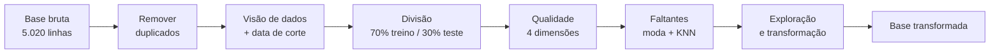

# Previsão de churn com aprendizado de máquina

Projeto da segunda parte da disciplina Sistemas Inteligentes (CIn/UFPE, 2026.2). A pergunta que a gente tenta responder: dado um cliente de uma operadora, ele vai cancelar o plano nos próximos 60 dias?


## Equipe

| Integrante | Contato |
|---|---|
| Henrique Amorim | [hlpaa@cin.ufpe.br](mailto:hlpaa@cin.ufpe.br) |
| Henrique Passos | [hap@cin.ufpe.br](mailto:hap@cin.ufpe.br) |
| José Francisco Cruz Neto | [jfcn3@cin.ufpe.br](mailto:jfcn3@cin.ufpe.br) |
| Karoline Viana | [kvf@cin.ufpe.br](mailto:kvf@cin.ufpe.br) |
| Manoel Villarim | [mfav@cin.ufpe.br](mailto:mfav@cin.ufpe.br) |

## O problema

A operadora tem 5.000 clientes e quer saber quais deles vão sair antes que isso aconteça, para poder agir a tempo. Reter um cliente costuma sair mais barato que conquistar outro.

Do ponto de vista técnico é uma classificação binária: `churn = 1` se o cliente cancela em até 60 dias e `churn = 0` se fica.

## Miniprojetos

| # | Miniprojeto | Status |
|---|-------------|--------|
| 1 | Análise, tratamento e construção da base de dados de churn | Concluído |
| 2 | Algoritmos supervisionados (Árvores de Decisão, Gradient Boosting, MLP) | A fazer |
| 3 | Algoritmos não supervisionados (K-means, K-prototypes, DBSCAN) | A fazer |

## Miniprojeto 1

Todo o trabalho está no notebook [`Analise_tratamento_Churn.ipynb`](Analise_tratamento_Churn.ipynb). Os passos, na ordem em que aparecem:



### Base bruta

A base veio com valores faltantes, mensalidades negativas ou absurdamente altas, textos escritos de formas diferentes (`bienal `, `Cartao`) e 20 clientes duplicados.

<p align="center"></p>

### Visão de dados e data de corte

Montamos uma linha por cliente. A data de corte fica 60 dias antes do fim da base: os atributos usam só o que se sabia até ali, e o churn é observado nos 60 dias seguintes. Calcular o tempo de casa com a data do cancelamento seria dar o alvo de presente ao modelo, então evitamos isso.

### Divisão treino e teste

Separamos 70% para treino e 30% para teste, estratificando pelo churn, logo depois de montar a visão de dados e antes de calcular qualquer estatística. Moda, KNN, média e desvio padrão saem só do treino. O teste só recebe a transformação (`.fit` no treino, `.transform` no teste).

<p align="center"></p>

### Qualidade dos dados

Medimos completude, validade, consistência e unicidade antes e depois do tratamento. Os valores fora das faixas do inventário viraram nulos, e a validade foi a 100%. A completude que sobrou é resolvida na imputação.

<p align="center">
  
  
</p>

### Faltantes

Para cada coluna analisamos se a ausência parecia aleatória (MCAR) ou ligada a outras variáveis (MAR). As categóricas foram preenchidas com a moda do treino e as numéricas com `KNNImputer`.

### Exploração e transformação

Olhamos a distribuição de cada variável por classe, a estatística KS e a correlação de Pearson. Depois discretizamos as numéricas em faixas escolhidas por uma árvore rasa (bins preditivos) e padronizamos com `StandardScaler`.

## Números

| | |
|---|---|
| Registros brutos | 5.020 (20 duplicados removidos, sobram 5.000 clientes) |
| Clientes elegíveis na data de corte | 4.990 |
| Churn na janela de 60 dias | cerca de 35,5% |
| Treino e teste | 3.493 e 1.497, com a mesma proporção de churn nos dois |

## O que os dados mostram

O tempo de casa é o que mais protege. O churn passa de 60% nos primeiros 6 meses e cai para menos de 10% depois de 5 anos. Os chamados de suporte puxam para o outro lado: a taxa vai de uns 22% em quem não abriu nenhum para mais de 60% em quem abriu 5 ou mais.

<p align="center"></p>

O contrato mensal tem cerca de 48% de churn, contra uns 24% no anual e 15% no bienal. A forma de pagamento quase não muda o resultado.

<p align="center"></p>

Juntando três fatores (até 18 meses de casa, 2 ou mais chamados e pelo menos 1 atraso), criamos o "combo de risco triplo". Ele pega cerca de 15% dos clientes, e esses têm uns 63% de churn, o dobro do resto.

<p align="center"></p>

As variáveis têm pouca correlação entre si, então nenhuma é redundante.

<p align="center"></p>

A base tratada tem sinal suficiente para o próximo miniprojeto. Tempo de cliente, chamados, atrasos e tipo de contrato são as variáveis que mais separam as duas classes.

## Estrutura do repositório

```
churn-previsao-ml/
├── Analise_tratamento_Churn.ipynb   # análise e tratamento (miniprojeto 1)
├── base_churn_5000_VF2_aluno.xlsx   # base bruta
├── treino_tratado.csv               # base transformada, treino (70%)
├── teste_tratado.csv                # base transformada, teste (30%)
├── imagens/                         # gráficos usados neste README
└── README.md
```

## Como rodar

```bash
git clone https://github.com/Henrique-apassos/churn-previsao-ml.git
cd churn-previsao-ml
pip install pandas numpy matplotlib seaborn scikit-learn scipy openpyxl jupyter
jupyter notebook Analise_tratamento_Churn.ipynb
```

Também dá para abrir no Google Colab, enviando a base `.xlsx` junto com o notebook. Ao rodar tudo até o fim, ele gera `treino_tratado.csv` e `teste_tratado.csv`.

Bibliotecas usadas: pandas, NumPy, scikit-learn, SciPy, Matplotlib e Seaborn.
